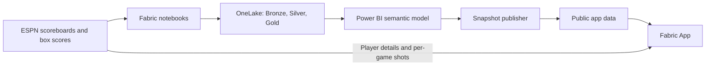

<h1 align="center">HoopMetrics</h1>

<p align="center">
  An NBA analytics application built with Microsoft Fabric, from data ingestion to an interactive Fabric App.
</p>

<p align="center">
  
  
  
  
  
</p>

<p align="center">
  <a href="#features">Features</a> ·
  <a href="#architecture">Architecture</a> ·
  <a href="#getting-started">Getting Started</a> ·
  <a href="#documentation">Documentation</a>
</p>

<p align="center">
  <a href="https://vast-aspen-e38fa96203-brazilsouth.webapp.fabricapps.net/">
    
  </a>
</p>

---

## About

HoopMetrics brings NBA games, teams and player statistics together in a
public-facing Fabric App. It demonstrates how Microsoft Fabric can support
the complete journey from data ingestion and analytical modeling to an
interactive application designed for exploration.

The solution collects ESPN scoreboards and box scores, processes them in
OneLake, and uses a Power BI semantic model as its analytical foundation.
A curated data copy allows public access to the app without exposing the
private semantic model.

## Features

- **League:** explore standings, conferences, season progress and statistical leaders.
- **Games:** browse results and upcoming games in list or calendar views;
  inspect scores, box scores and team comparisons.
- **Teams:** view team results, statistics, participating players and leaders.
- **Players:** explore player profiles, game logs, season statistics and
  per-game shot maps.
- **Connected exploration:** navigate between games, teams and players while
  keeping season and phase context.

Standings and rankings are calculated from available data and are not official
league rankings. The shot map uses approximate ESPN play-by-play coordinates
for an individual game; it is not a season-wide shot map.

## Architecture



The Fabric pipeline orchestrates ingestion, transformations, model refresh and
publication. In the existing deployment, it is scheduled daily at 03:00 in
`E. South America Standard Time`. The app shows when its public data copy was
generated; it does not display live data. Some player information, season dates
and shot data are requested directly from ESPN by the browser.

See [Architecture](./docs/architecture.md) and
[Data Engineering](./docs/data-engineering.md) for the full data flow.

## Repository

| Directory | Contents |
| --- | --- |
| [app_nba_stats](./app_nba_stats/) | Fabric App source, data access, publisher and tests |
| [notebooks](./notebooks/) | Fabric ingestion and transformation notebooks |
| [fabric-artifacts/pipeline](./fabric-artifacts/pipeline/) | Pipeline definition with environment identifiers replaced |
| [semantic-model](./semantic-model/) | Semantic model TMDL definition with environment identifiers replaced |
| [config](./config/) | Configuration templates |
| [docs](./docs/) | Architecture, implementation and product documentation |

## Getting Started

To explore or adapt the solution, you need a Microsoft Fabric workspace and
capacity, a Lakehouse, a semantic model and the permissions required to run
notebooks, refresh the model and configure a Fabric App.

For the app's local development and checks, use Node.js 24:

```powershell
cd app_nba_stats
npm install
npm test
npm run build
```

The app also requires a configured Fabric backend or a suitable local snapshot
to display data. Follow the [implementation guide](./docs/implementation-guide.md)
to configure the Lakehouse, model, app, pipeline and schedule. The pipeline and
model definitions contain placeholders and require manual configuration; they
are not a validated one-click deployment.

## Documentation

| Guide | What it covers |
| --- | --- |
| [Architecture](./docs/architecture.md) | Components, data flow and public-access design |
| [Data Engineering](./docs/data-engineering.md) | Ingestion, notebooks, Delta layers and orchestration |
| [Semantic Model](./docs/semantic-model.md) | Tables, relationships, measures and app integration |
| [Fabric App](./docs/fabric-app.md) | Features, source structure and data access |
| [UX and UI Decisions](./docs/ux-ui-decisions.md) | Navigation, interaction patterns and product design |
| [Implementation Guide](./docs/implementation-guide.md) | Prerequisites, configuration and troubleshooting |
| [Lessons Learned](./docs/lessons-learned.md) | AI-assisted development and practical takeaways |
| [Security and Rights](./docs/security-and-rights.md) | Dependency, privacy, licensing and third-party content considerations |
| [Contributing](./CONTRIBUTING.md) | Development checks and contribution guidelines |

## Data and usage

HoopMetrics is not affiliated with the NBA or ESPN. Source availability and
coverage depend on ESPN, and its endpoints may change. Data, logos, photos
and other third-party content have separate usage rights. Project-owned source
is provided under the [MIT License](./LICENSE); existing
third-party components retain their own licenses. Consult
[Security and Rights](./docs/security-and-rights.md) before redistributing
third-party data or content.
