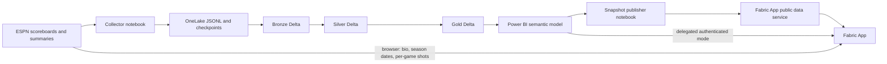

# Architecture

HoopMetrics separates data ingestion, analytical modeling and public delivery.
The [implementation guide](./implementation-guide.md) describes the manual
configuration needed to reproduce this topology.

The pipeline runs notebook activities sequentially with 60-second waits.
The final Gold notebook requests and awaits model refresh during pipeline
execution; the publisher then queries a field allowlist, validates row counts
and publishes a complete version. The anonymous app reads the public copy,
not the private model. A separate authenticated mode uses delegated access.

This boundary avoids giving every visitor model access, but public copies
must contain only fields approved for disclosure. Anonymous delivery does not
make ESPN content freely redistributable. The app can show a previous complete
copy if a publication fails. Old versions are not automatically cleaned up.

Fabric schedules are configured independently of the pipeline definition,
and are not included in the exported JSON. The lakehouse uses table-name
prefixes for layers, not schemas or security boundaries.
